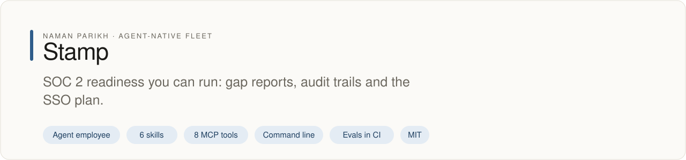

# stamp

<!-- fleet:header:start -->
<p align="center"><picture><source media="(prefers-color-scheme: dark)" srcset="assets/banner-dark.svg"></picture></p>

<p align="center">
<a href="https://github.com/naman10parikh/stamp/actions/workflows/ci.yml"></a>
<a href="https://github.com/naman10parikh/stamp/releases"></a>
<a href="LICENSE"></a>
<a href="#use-it-from-any-coding-agent"></a>
<a href="https://x.com/naman10parikh"></a>
<a href="https://www.linkedin.com/in/naman-parikh1/"></a>
</p>

<p align="center"><a href="#quick-start">Quick start</a> · <a href="https://naman10parikh.github.io/stamp/">Website</a> · <a href="docs/README.md">How it works</a> · <a href="AGENTS.md">AGENTS.md</a> · <a href="llms.txt">llms.txt</a> · <a href="skills/">Skills</a> · <a href="https://github.com/naman10parikh/stamp/discussions">Discussions</a> · <a href="https://github.com/naman10parikh">All projects</a></p>

**SOC 2 readiness you can run: gap reports, audit trails and the SSO plan.**

Stamp is an agent employee, a packaged specialist agent with its own skills, memory and tests. It owns one job: compliance and SSO. Coding agents use it through its skills, its MCP server and its command line. Its evals gate every merge in CI. A person makes every change.

_Stamp is part of an agent-native play for agent-native systems that can eventually be recursively self-improving and evolving, operated by agent employees._

<p align="center"></p>
<!-- fleet:header:end -->

Stamp is for teams that sell software to companies who ask for SOC 2, single sign-on and a security review before
they sign. It gap-scans an app against SOC 2 controls, plans the enterprise SSO program, designs a tamper-evident
audit trail, and drafts privacy-request replies and security questionnaires for a person to sign. It never says
"compliant": it assembles audit-ready evidence, and the auditor attests.

<!-- fleet:use:start -->
## Use it from any coding agent

**Claude Code**: the plugin brings the skills, sub-agents, hooks and MCP server.

```
/plugin marketplace add naman10parikh/stamp
/plugin install stamp@stamp
```

<details><summary>Its MCP server, Codex, Cursor, Gemini CLI, one skill and the command line</summary>

**Its MCP server**, in any MCP client:

```bash
claude mcp add --transport stdio stamp -- npx -y -p github:naman10parikh/stamp stamp-mcp
codex mcp add stamp -- npx -y -p github:naman10parikh/stamp stamp-mcp
```

Cursor (`.cursor/mcp.json`), Gemini CLI (`.gemini/settings.json`) and most other clients take the same command as JSON:

```json
{
  "mcpServers": {
    "stamp": {
      "command": "npx",
      "args": [
        "-y",
        "-p",
        "github:naman10parikh/stamp",
        "stamp-mcp"
      ]
    }
  }
}
```

**Gemini CLI**: the extension brings the context and the MCP server.

```bash
gemini extensions install https://github.com/naman10parikh/stamp
```

**One skill** (6 in all, in [skills/](skills/)), in any agent that reads Agent Skills:

```bash
gemini skills install https://github.com/naman10parikh/stamp --path skills/soc2-readiness-audit
git clone --depth 1 https://github.com/naman10parikh/stamp /tmp/stamp && cp -r /tmp/stamp/skills/soc2-readiness-audit ~/.claude/skills/
```

**The command line:**

```bash
npx -y -p github:naman10parikh/stamp stamp --help
```

</details>

Codex, Cursor, OpenCode, GitHub Copilot and other agents read [AGENTS.md](AGENTS.md); Claude Code reads [CLAUDE.md](CLAUDE.md) and Gemini CLI reads [GEMINI.md](GEMINI.md), which import it. [llms.txt](llms.txt) maps every surface for agents that read first.
<!-- fleet:use:end -->

## Quick start

```bash
git clone https://github.com/naman10parikh/stamp && cd stamp
pnpm install && pnpm build
node bin/stamp audit test/fixtures/app-under-audit --framework soc2                     # a control-mapped gap report
node bin/stamp sso-plan --target test/fixtures/app-under-audit --acv 300000 --dry-run   # the SSO program plan
node bin/stamp advise --on pentest                                                       # a decision with its honest cost
bash scripts/brain-search.sh "tamper-evident audit trail"                                # ranked, cited hits from the brain
pnpm test && pnpm run eval && pnpm run acceptance                                        # tests, the eval gate, the acceptance bar
```

Every command takes `--json` for agents. None of these needs an account or a key. The optional model-graded eval
step runs only when `ANTHROPIC_API_KEY` is set; without it, it is skipped.

## How it works

- **The boundary comes first.** Every task is placed on one line. Making SAML, OIDC or SCIM work is badge's job:
  stamp returns a handoff to badge, never auth code. The posture, the evidence and the program are stamp's. The
  router in `src/dispatch/route.ts` applies this gate first, then maps any other task to one of stamp's commands.
- **The brain is the asset.** Six files in `brain/` hold the decision map, 16 dated incidents, 25 pitfalls, 25
  opinions, the open disputes and the tool matrix (Vanta, Drata, WorkOS, Cobalt). The command line, the MCP server
  and the skills route a task to the right entry and run the deterministic part.
- **It refuses the shortcuts.** It never claims "compliant", never accepts an AI-only pen test, never revokes access
  by itself, and marks every questionnaire answer as a draft a person must sign. The `compliance-lint` hook blocks
  those claims, and a committed secret, at write time.
- **Every run leaves a trail.** Each command appends a line to `logs/runs.jsonl` with the accountable person
  (`STAMP_HUMAN_OWNER`, else the operating-system user). `stamp runs` summarizes the trail.
- **A local cockpit.** `bash scripts/serve.sh` serves a small page on port 7799: browse and search the brain, read
  the run trail and the eval status, and ask for a gap report, an SSO plan or a decision.

<!-- fleet:anatomy:start -->
## What it is made of

Every project in this fleet is graded on the same 11 harness components and on self-improvement. Each mark is backed by a file you can open.

| Component | Grade | Where |
| --- | --- | --- |
| Identity | ✅ | identity/SOUL.md:1 identity/BRAND.md:6 |
| Memory | ✅ | memory/MEMORY.md:1 scripts/brain-search.sh:1 memory/LEARNINGS.md:5 |
| Skills | ✅ | skills/soc2-readiness-audit/SKILL.md:1 skills/grc-platform-advisor/SKILL.md:1 |
| Tools/CLIs | ✅ | package.json:7 bin/stamp:1 src/cli/index.ts:1 |
| Hooks | ✅ | .claude/settings.json:10 hooks/hooks.json:8 .claude/hooks/compliance-lint.js:1 |
| Sub-agents | ✅ | .claude/agents/stamp-soc2-gap-auditor.md:2 .claude/agents/stamp-dsar-handler.md:2 |
| MCPs | ✅ | src/mcp/server.ts:1 package.json:8 .mcp.json:3 |
| Dispatch | ✅ | src/dispatch/route.ts:48 .github/workflows/rsi.yml:11 |
| Evals | ✅ | eval/run.mjs:1 .github/workflows/acceptance.yml:32 |
| Observability | ✅ | src/lib/runlog.ts:17 scripts/runs-view.mjs:1 |
| Sandbox/Infra | ✅ | sandbox/README.md:13 .github/workflows/acceptance.yml:35 |
| Self-improvement | ✅ | dsip.json:1 workflows/rsi.workflow.js:1 .github/workflows/rsi.yml:11 |

✅ real and tested · 🟡 partial, with the reason in the row · ❌ absent
<!-- fleet:anatomy:end -->

<!-- fleet:footer:start -->
## How it improves itself

It carries its own evals and a self-improvement contract, [`dsip.json`](dsip.json), which says what it may change and how a change is judged. Its evals gate every merge in CI. A person makes every change. Lessons it learns are kept as rules in its memory files.

## Part of a fleet

One of the projects by [Naman Parikh](https://github.com/naman10parikh). Each owns one part of an agent's harness, or of the product around an agent, and all of them follow one standard.

| Related project | What it owns |
| --- | --- |
| [AgentDial](https://github.com/naman10parikh/agentdial) | Identity |
| [WikiMem](https://github.com/naman10parikh/wikimem) | Memory |
| [Skillsmith](https://github.com/naman10parikh/skillsmith) | Skills |
| [Agent Booster](https://github.com/naman10parikh/agent-booster) | Tools / CLIs |
| [Hooksmith](https://github.com/naman10parikh/hooksmith) | Hooks |
| [AgentCast](https://github.com/naman10parikh/agentcast) | Sub-agents |
| [Plugsmith](https://github.com/naman10parikh/plugsmith) | Plugins |
| [Armory](https://github.com/naman10parikh/armory) | MCPs and the component registry |
| [AgentGrid](https://github.com/naman10parikh/agentgrid) | Dispatch |
| [AgentSwarm](https://github.com/naman10parikh/agentswarm) | Dispatch |
| [AgentBench](https://github.com/naman10parikh/agentbench) | Evals |
| [AgentMoney](https://github.com/naman10parikh/agentmoney) | Observability |
| [Sandforge](https://github.com/naman10parikh/sandforge) | Sandbox / Infra |
| [Claude Harness](https://github.com/naman10parikh/claude-harness) | The whole harness, as a template |

## Community

Questions and ideas go to [Discussions](https://github.com/naman10parikh/stamp/discussions); bugs go to [issues](https://github.com/naman10parikh/stamp/issues/new/choose). Follow the work on [X](https://x.com/naman10parikh) and [LinkedIn](https://www.linkedin.com/in/naman-parikh1/).

## Contributing and security

Read [CONTRIBUTING.md](CONTRIBUTING.md). AI-assisted pull requests are welcome. Report a vulnerability privately, as [SECURITY.md](SECURITY.md) explains.

## License

MIT, © 2026 Naman Parikh. See [LICENSE](LICENSE) and [NOTICE](NOTICE).

## Star history

If it is useful to you, a star helps other people find it.

<a href="https://star-history.com/#naman10parikh/stamp&Date"><picture><source media="(prefers-color-scheme: dark)" srcset="https://api.star-history.com/svg?repos=naman10parikh/stamp&type=Date&theme=dark"></picture></a>

## Contributors

<a href="https://github.com/naman10parikh/stamp/graphs/contributors"></a>
<!-- fleet:footer:end -->
