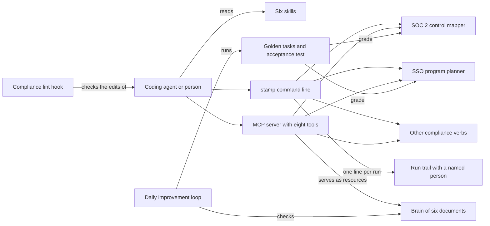

# How Stamp works

Stamp is for teams that sell software to companies who ask for SOC 2, single sign-on and a security review before they sign. SOC 2 is an audit of a company's security controls, attested by an outside accounting firm. Stamp scans an app for missing SOC 2 evidence and plans the single sign-on (SSO) program. It also designs a tamper-evident audit trail, and drafts privacy-request replies and questionnaire answers for a person to sign. It never says "compliant". It assembles the evidence, and the auditor attests.

## The parts



An agent reaches Stamp through its [skills](../skills/), its command line or its MCP server. MCP (Model Context Protocol) is a standard way for an agent to call tools. [bin/stamp](../bin/stamp) loads the built command line from [src/cli/index.ts](../src/cli/index.ts), which registers nine commands from [src/cli/commands/](../src/cli/commands/). The MCP server in [src/mcp/server.ts](../src/mcp/server.ts) offers eight tools and serves the brain files as resources. Both call the same libraries in [src/lib/](../src/lib/), so the answer does not depend on the surface.

[src/lib/control-mapper.ts](../src/lib/control-mapper.ts) runs the SOC 2 gap scan. [src/lib/sso-program.ts](../src/lib/sso-program.ts) plans the SSO program and hands the sign-in code to a separate auth tool. [src/lib/verbs.ts](../src/lib/verbs.ts) holds the audit-trail, access-review, data-residency, privacy-request, questionnaire and advice verbs. [src/lib/runlog.ts](../src/lib/runlog.ts) writes the run trail. The hook in [.claude/hooks/compliance-lint.js](../.claude/hooks/compliance-lint.js) blocks four kinds of text at write time, such as a "we are compliant" claim or a secret. [src/dispatch/route.ts](../src/dispatch/route.ts) classifies a task as sign-in plumbing or compliance work. The command line and the MCP server do not call it, and [test/route.test.ts](../test/route.test.ts) shows how it routes.

## What happens when you run it

The main flow is `stamp audit ./my-app --framework soc2`.

1. [bin/stamp](../bin/stamp) imports the built command line and calls `main`, defined in [src/cli/index.ts](../src/cli/index.ts).
2. [src/cli/commands/audit.ts](../src/cli/commands/audit.ts) parses the path, the framework and `--json`.
3. `withRunLog` in [src/lib/runlog.ts](../src/lib/runlog.ts) starts a timer and resolves the accountable person. It uses `STAMP_HUMAN_OWNER`, or else your operating-system user.
4. `scanForGaps` in [src/lib/control-mapper.ts](../src/lib/control-mapper.ts) reads the file names and contents under the path.
5. It checks five load-bearing SOC 2 controls: CC7.2, CC6.3, CC8.1, CC6.1 and CC7.1. A control with no evidence words becomes a finding.
6. Each finding carries a severity, the evidence gap, a fix and a citation into [brain/](../brain/).
7. [src/cli/output.ts](../src/cli/output.ts) prints the report, or JSON with `--json`. The summary counts the gaps and says the auditor attests.
8. The run trail in [logs/runs.jsonl](../logs/runs.jsonl) gains one line with the command, duration, outcome and person.

The second half of the acceptance bar is `stamp sso-plan --target ./my-app --acv 300000 --dry-run`. ACV is the deal's annual contract value. The plan returns a build-now decision, a buyer checklist, a wiring plan and a deprovisioning proof spec. It also returns a `badge_handoff` field instead of any SAML or SCIM code.

## Extending it

- **A command.** Add a file in [src/cli/commands/](../src/cli/commands/) that exports a `register` function, like [src/cli/commands/residency.ts](../src/cli/commands/residency.ts). Call it in `buildProgram` in [src/cli/index.ts](../src/cli/index.ts). Put the logic in [src/lib/](../src/lib/), and wrap the action in `withRunLog`.
- **An MCP tool.** Add an entry to the `TOOLS` array in [src/mcp/server.ts](../src/mcp/server.ts). Give it a name, a JSON Schema input and a handler that calls the same library. Update the expected names in [test/mcp.test.ts](../test/mcp.test.ts).
- **A skill.** Add `skills/<name>/SKILL.md`, following [skills/soc2-readiness-audit/SKILL.md](../skills/soc2-readiness-audit/SKILL.md).
- **An eval.** Add a task to [eval/golden-tasks.json](../eval/golden-tasks.json) with a `handler`, its `args`, the `required_phrases` and the `forbidden_phrases`. A new handler also needs a case in `runHandler` in [eval/run.mjs](../eval/run.mjs). A task passes when its F1 score on the required phrases is at least 0.8 and no forbidden phrase appears.
- **A control.** Add an entry to `SOC2_CHECKS` in [src/lib/control-mapper.ts](../src/lib/control-mapper.ts), with its evidence words, severity, fix and brain citation.
- **Expertise.** Add to the matching document in [brain/](../brain/). `bash scripts/brain-search.sh "<query>"` searches it.

Then run `pnpm build && pnpm test && pnpm run eval && pnpm run acceptance`. CI runs the same gate in [.github/workflows/acceptance.yml](../.github/workflows/acceptance.yml).

## Questions

**Does it need an API key or cost money?**
No. The command line, the MCP server, the tests, the eval and the acceptance test need no account and no key. One optional script, `node eval/l3-judge.mjs`, asks the Claude model you name in `STAMP_JUDGE_MODEL` to grade six judgment tasks when `ANTHROPIC_API_KEY` is set too. That call costs API credit. `pnpm run eval` never calls it.

**Does any data leave the machine?**
Not in normal use. The scan reads local files, and the run trail is a local file. With `ANTHROPIC_API_KEY` set, the optional judge sends Stamp's answers and the expected resolutions to the Anthropic API. The run trail is a tracked file that records a user name, so your runs show up in `git status`. The local page from `bash scripts/serve.sh` listens on 127.0.0.1, port 7799.

**How does it improve itself?**
Its self-improvement contract, [dsip.json](../dsip.json), names one level, `agent`, a nightly loop and `noSelfGrading: true`. [.github/workflows/rsi.yml](../.github/workflows/rsi.yml) runs [workflows/rsi.workflow.js](../workflows/rsi.workflow.js) with `--dry-run` every day at 07:17 UTC. It checks that the six brain files exist and that the tool matrix still records its key facts. Then it re-runs the eval and reports any failure. It never rewrites a brain file. A second half, which would rewrite the brain, waits on a `CLAUDE_CODE_OAUTH_TOKEN` secret.

**How do I run its tests or checks?**

```bash
pnpm install && pnpm build
pnpm test                 # unit and structural tests, with vitest
pnpm run eval             # structural checks and the golden tasks, graded against fixed phrases
pnpm run acceptance       # audit and sso-plan on the fixture app, three runs that must match
npx playwright test       # the local page, end to end
```

**What does it not do?**
It never claims "compliant" or "certified". It writes no SAML, OIDC or SCIM code. It never revokes access by itself, and every questionnaire answer is a draft a person must sign. The gap scan is a static check of five controls, not an audit. The framework flag accepts `iso27001` and `hipaa`, but the scan runs the same SOC 2 checks.
